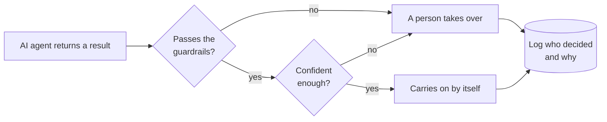
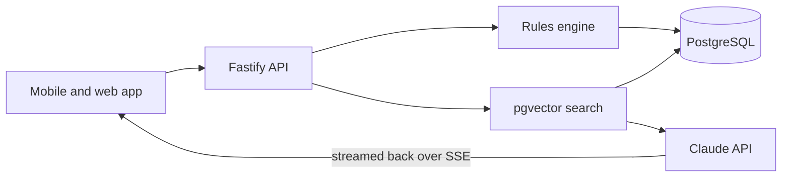

# Hi, I'm Ruchira

AI Product Engineer at Arbitr, in Auckland. This is where my side projects and code examples live. For the work story, see my [portfolio](https://lordmaduz.github.io/ruchira.codes/).

## A shape I keep building

Most of the AI features I work on end up with this shape. LandedNZ follows it too: a rules engine makes the plan, and the AI chat only answers questions about it.

## Building on my own: LandedNZ

A planner for people moving to New Zealand. You tell it your visa, city, family and arrival date, and it builds the list of things to sort out first. The [backend](https://github.com/LordMaduz/landednz-be) and the [app](https://github.com/LordMaduz/landednz) are both public.

How it's put together

Sign-in uses Supabase Auth, and Prisma handles the database. The chat finds the relevant settlement notes with pgvector, then Claude writes the answer and streams it back as it goes.

## Repos by topic

<b>AI and agents</b>

- [AI-Agentic](https://github.com/LordMaduz/AI-Agentic): worked examples with LangGraph and LlamaIndex, from basic tool use to routing and RAG
- [landednz-be](https://github.com/LordMaduz/landednz-be): the LandedNZ backend, with streaming RAG chat over pgvector

<b>Reactive Java</b>

- [Realtime-Event-Processing-With-Reactive-gRPC](https://github.com/LordMaduz/Realtime-Event-Processing-With-Reactive-gRPC): reactive gRPC between Spring services, with Protocol Buffers and JWT auth
- [Reactive-Programming-with-GraphQL-and-Spring](https://github.com/LordMaduz/Reactive-Programming-with-GraphQL-and-Spring): a GraphQL API on Spring WebFlux, with live subscriptions over WebSocket

<b>Running services in production</b>

- [Observability-In-Spring-Boot-3-With-OpenTelemetry](https://github.com/LordMaduz/Observability-In-Spring-Boot-3-With-OpenTelemetry): traces, metrics and logs with OpenTelemetry, Prometheus, Grafana, Tempo and Loki
- [Dynamic-Config-Management-With-Spring-Cloud-Config-Server](https://github.com/LordMaduz/Dynamic-Config-Management-With-Spring-Cloud-Config-Server): one config server for many services, with live refresh over Spring Cloud Bus
- [Hibernate-6-Advanced-Features](https://github.com/LordMaduz/Hibernate-6-Advanced-Features): naming strategies and compile-time query checks with the JPA metamodel
- [Data-Transformation-Framework](https://github.com/LordMaduz/Data-Transformation-Framework): turns FX trade instructions into booking records using rules you can configure

## Ask me

Why Python after years of Java?

Arbitr's services are written in Python, so I picked it up on the job, along with FastAPI and Vue with Nuxt. Most of the examples on this page are still Java.

Are you open to new roles?

Yes, in Auckland. [Book a 20-minute chat](https://cal.com/ruchira-rajapaksha) or message me on [LinkedIn](https://www.linkedin.com/in/ruchirarajapaksha/).

Where do you write?

On [Medium](https://medium.com/@maduz.ruchira), mostly about the systems I work on. I've also written tutorials for [Baeldung](https://www.baeldung.com/author/ruchiramadhushanrajapaksha). The latest posts are below.

Something else? [Open an issue](https://github.com/LordMaduz/LordMaduz/issues/new?title=Question%20for%20Ruchira) on this repo and I'll answer there.

## Latest posts

<!-- BLOG-POST-LIST:START -->
- [Are You Giving Away Your Writing’s Worth with Friend Links?](https://medium.com/illumination/are-you-giving-away-your-writings-worth-with-friend-links-54f62aea8d11)
- [Is Partitioning for Targeted Data Access Still the Master Plan of Database Design?](https://levelup.gitconnected.com/is-partitioning-for-targeted-data-access-still-the-master-plan-of-database-design-1684d7bbb0a7)
- [Is Modern Concurrency Aligned with Joe Armstrong’s Actor Model and Simplicity Principles?](https://levelup.gitconnected.com/is-modern-concurrency-aligned-with-joe-armstrongs-actor-model-and-simplicity-principles-a6c67d47c092)
- [I Studied Reactor Kafka So You Don’t Have To: Handling BackPressure (Part 1)](https://levelup.gitconnected.com/i-studied-reactor-kafka-so-you-dont-have-to-here-s-what-i-learned-handling-backpressure-part-1-f7ffca82295a)
- [Is Rust a Pure Functional Programming Language Or Just Pretending To Be One?](https://levelup.gitconnected.com/is-rust-a-functional-programming-language-or-just-pretending-to-be-one-d03cf8db38c9)
<!-- BLOG-POST-LIST:END -->

[Portfolio](https://lordmaduz.github.io/ruchira.codes/) · [LinkedIn](https://www.linkedin.com/in/ruchirarajapaksha/) · [Hugging Face](https://huggingface.co/maduzrajapaksha)

Off the clock I'm usually on the PlayStation.
